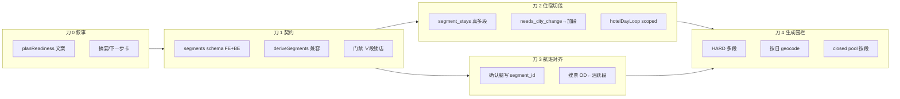

# 38 · 多城城段（FLOW-MC）实施影响与联动改动清单

> **日期**：2026-08-12  
> **进度**：刀 1–4 ✅；ORDER（含气候薄层）✅；P130 ✅；P131 仅 A（扩 LLM 区数），B/D 目录仍待拍板  
> **前提**：已认同 [37](./37-多城割裂与单城组合策略.md) 路线 **A（多个单城组合）**，不做一步到位联合规划。  
> **本文目标**：回答「这是大改动，细节点很多——**哪些必须一起改、怎么改、分几刀切**」。  
> **关联**：P133 · FLOW-MC · P128 / P122 / P131 / P129 · [18 §5](./18-机酒优先与迭代行程产品决策.md) · [06](./06-机酒确认与行程生成流程方案.md) · [39 决策因子](./39-多城先去哪决策因子.md) · travel-product-flow

---

## 0. 一句话

多城不是「多搜几次机票」就能闭环。真正缺的是 **城段（segment）作为一等公民**：日期窗、进出港腿、本城酒店、本城围栏/玩法池都挂在段上。  
**另外**：段「怎么排、先去哪」见 [39](./39-多城先去哪决策因子.md)（航班序冻结、气候季、花期窗等）——38 管容器，39 管排序冲突。  
因此改动面大，但可以按 **契约批次** 切：每一刀必须「schema + 门禁 + 至少一个消费方」同发，避免半套模型更割裂。

---

## 1. 为什么「细节点」会爆炸

当前链路表面是：

```
destination(string) → 航班(可多段) → 任意一家锁店 → generate(一个围栏)
```

后端住宿切分更直白——`segment_stays()` **永远只返回 1 段**，且 `city = trip_request.destination`：

```26:62:backend/app/services/stay_zone/segment.py
def segment_stays(...) -> list[StaySegment]:
    """Phase 1：同城整段为 1 segment；..."""
    destination = (trip_request.get("destination") or "").strip() or "目的地"
    ...
    return [StaySegment(city=destination, ...)]
```

于是任何「看起来像多城」的 UI（多航段模板、需换城 tag、多酒店 covers_day）都会在下游被压回单城。细节点不是遗漏功能，而是 **同一假设在十几处重复**：

| 重复假设 | 典型表现 |
|----------|----------|
| 一个目的地字符串 | FormPatch / parse / 摘要 / geocode / 印证 query |
| 「有任意一家酒店即可生成」 | `hasLockedHotel` / `_require_locked_hotel` |
| 换城 = 错误 | `needs_city_change` 禁确认；对话 fork |
| 第一家店 / 去程抵达 = 全图锚 | closed_poi_pool、geocode_bias、flightArrivalCity |
| 换店覆盖全部过夜日 | hotelDayLoop / intel_anchor（P128） |

**不一起改的后果**：例如只加 `segments[]` 不改门禁 → 用户填了两城仍一家店可生成；只改门禁不改 `segment_stays` → 第二城永远推不出片区。

---

## 2. 目标契约（实施真相源）

### 2.1 推荐 schema（兼容旧单城）

```ts
// trip_request
{
  destination: string;           // 兼容：展示用主目的地/国家；单城时 = segments[0].city
  departure?: string;
  date_start?: string;           // 整趟窗（可与 segments 推导互相同步）
  date_end?: string;
  segments?: CitySegment[];      // 多城真相源；缺省则视为单段[destination]
}

type CitySegment = {
  id: string;                    // seg_1
  city: string;                  // 胡志明 / 芽庄
  date_start: string;            // 入住/到达日本城
  date_end: string;              // 离开日本城（通常 = 下一段 date_start）
  role?: 'hub' | 'leg';          // 可选
};
```

```ts
// travel_intel 挂载（最小）
flight: { ..., sequence, role, segment_id?: string }
hotel:  { ..., city, check_in, check_out, segment_id, is_primary /* per segment */ }
zone:   { ..., city, covers_day_indices, segment_id?, fit_tag }
```

```ts
// itinerary day（MC-3）
day: { day, date, segment_id?, region? /* region 仍可表片区，勿与城段混名 */ }
```

**兼容规则（必须写进代码与测试）**

1. `segments` 空或未传 → 合成一段：`[{ id: 'seg_1', city: destination, date_start, date_end }]`  
2. 改 `segments[0].city` 时可选同步 `destination`（显示）  
3. 旧计划无 `segment_id` 的酒店/航班 → 全部归属 `seg_1`  
4. **禁止**用「最后搜票的 destination」静默覆盖整趟 `destination` 而不写 segments

### 2.2 产品状态机（替代线性 destination→flight→stay）

```
for each segment in order:
  需要：覆盖该段的进港/城际腿（规则可渐进）
  需要：该段 ≥1 锁定酒店(名+坐标) 且 check 落在段日期窗
then:
  canGenerate = true
换城日 / 城际日：允许无过夜酒店（对称 P92 返程日）
```

门禁从「任意一家店」改为 **∀ segments 已锁店**（单城退化后行为与今天一致）。

---

## 3. 「必须一起改」的批次（比 MC-0..3 更细的可发版刀）

原则：**每一刀同时满足 (契约写入) + (至少一处读写) + (门禁或测试不撒谎)**。



| 刀 | 名称 | **同发必改**（缺一不可） | 可暂缓 | 状态 |
|----|------|--------------------------|--------|------|
| **0** | 叙事 | `planReadiness` / 摘要：多段时显示城段进度 | schema、generate | 部分随 MC-1 |
| **1** | 契约+门禁 | FE/BE `segments`；`deriveSegments()`；∀段锁店 | 片区 UI 大改 | **✅ 2026-08-12** |
| **2** | 住宿切段 | `segment_stays`；需换城→加段；P128 scoped | P131 目录 | **✅ 2026-08-12**（段选择器/按段 recommend 可后补） |
| **3** | 航班对齐 | 腿 `segment_id`；活跃段 OD | 联合报价 | **✅ 2026-08-12** |
| **4** | 生成/GEO | HARD 按段；按日 geocode/pool | 多时区 / 城际 Directions | **✅ 2026-08-12**（按日围栏+多锚池；城际真 Directions 仍可加深） |

**明确不要揉进同一 PR 的**

- P131 全国/城市片区目录（段内问题，可并行讨论）  
- P130 注意事项看板、P132 节点 tips（无关）  
- Ignav 多城联运 API、总花费联合最优  
- 一次 LLM「全球最优多城玩法」

---

## 4. 分域：要改什么、怎么改

### 4.1 数据与补丁（刀 1 核心）

| 文件 | 现状 | 怎么改 |
|------|------|--------|
| `frontend/src/types/tripRequest.ts` | 仅 `destination` | +`segments?`；`emptyTripRequest` 默认不填，由 derive 合成 |
| `backend/app/schemas/chat.py` `TripRequestIn` | 同上 | 同源字段；`FIELD_LABELS` 增加 `segments` / `segments[i].city` |
| `formPatchTool.ts` / `form_patch_tool.py` / `lowRiskPatches.ts` | 改 destination 低风险或 fork | **加段** ≠ fork；「换成另一国主目的地」才 fork；补丁支持 append/update segment |
| `chat_parse.py` | 「换城市 → fork」 | 意图：「再去清迈 3 天」→ append segment；「改去日本」→ fork 或清空 segments |

**派生函数（建议单文件，前后端语义对齐）**

```ts
// frontend/src/utils/citySegments.ts
deriveSegments(tr): CitySegment[]
activeSegment(tr, uiState): CitySegment
segmentForDate(segments, date): CitySegment | null
hotelsForSegment(hotels, segId)
allSegmentsHaveLockedHotel(tr, hotels): boolean
```

后端镜像：`app/services/trip_segments.py`（供 gate、`segment_stays`、generate 共用）。

### 4.2 门禁 / Ready（刀 0+1）

| 文件 | 现状 | 怎么改 |
|------|------|--------|
| `planReadiness.ts` | `canGenerate = dest && flights>0 && hasLockedHotel(任意)` | `canGenerate = deriveSegments 每段有锁店`；checklist 展开为「胡志明·住宿」「芽庄·住宿」或聚合「住宿 1/2 段」 |
| `usePlanStore.generateItinerary` | 同 FE 门禁 | 错误文案带 `missingSegmentIds` |
| `itineraries.py` `_require_locked_hotel` | 任意一家名+坐标 | 对 `derive_segments(body)` 每段至少一店；无 segments 时保持旧行为 |
| `getPlanningNextStep` | destination→flight→stay→generate | 变为：缺段日期 → 缺段航班（可选）→ **缺段酒店** → generate；文案「为第 2 城段锁店」 |

**刀 0 可先做假进度**：用「已确认航班目的地去重」估算城数，不改 schema——但只能当过渡，否则和真门禁再次打架。建议刀 0 极短，尽快上刀 1。

### 4.3 住宿（刀 2 · 最大产品面）

| 文件 | 现状 | 怎么改 |
|------|------|--------|
| `stay_zone/segment.py` | 恒 1 段 | 有 `segments[]` 则一段一 `StaySegment`；日索引按段日期窗切；段间日标为 transit（不进住宿 covers） |
| `recommend.py` / `prompt.py` / `stay_zones.py` | 整趟 destination | 入参 `segment_id`；prompt「本段 city 的 current_anchor」；启发式 zone 不得用整趟 destination 盖过 segment.city |
| `zone_tags.py` | 异城 → `needs_city_change` 不可订 | **同城相对「本段 city」** 才 bookable；异城保留 tag，但 UI 改为「加为下一段」 |
| `StayZonePanel.tsx` | `canRecommend=destination`；禁确认换城 | 「当前编辑段」选择器；recommend/lock 带 segment；换城 CTA 调 store `appendSegmentFromZone` |
| `confirmStayZone` / `confirmStayZoneHotel` / `addStandaloneHotel` | 全局；换城拒绝 | 写入 `hotel.segment_id`；**换店只重写该段 covers 日**（P128 必须同刀或紧前刀） |
| `hotelDayLoop.ts` | 后写酒店覆盖同日 | `applyHotelDayLoop(..., { scopeSegmentId \| replaceHotelId })`；禁止静默全量 |
| `intel_anchor_enforce.py` | 类似 dayOwner 覆盖；单 return 日 | 多段离开日；酒店按 segment/covers 放置 |
| `hotelIntelSync.ts` | `is_primary = sequence===1` | **每段**一个 primary |
| `flightArrivalCity.ts` / `geocode_bias.py` | 去程 outbound 抵达 | 本段 **入港腿** dest（段首城际/抵达） |
| lodging 日期 | 常用整趟 date_start/end | check_in/out = **段**窗 |

**与 P131 关系**：片区目录是「段内列出可搜区域」；没有 segment 先做目录，多城仍会把目录绑错城。**先刀 2，再 P131。**

### 4.4 航班（刀 3）

| 文件 | 现状 | 怎么改 |
|------|------|--------|
| `FlightIntelPanel.tsx` | multicity 只追加腿 + 提示 | 确认去程/城际时：`ensureSegmentForLeg`；模板「多城」= 预创建空段或从 OD 推段 |
| `travelIntel.ts` `suggestNextFlightLeg` | 下一段 OD 空 dest | 预填 `nextSegment.city` 或「新增段」占位 |
| `flightToolTripSync.ts` | 搜票写死一个 destination | 写活跃段 city；刷新 display destination 策略显式化 |
| 腿字段 | 已有 sequence/role | +`segment_id`；intercity 腿可同时关闭上段、打开下段 |

**可保留**：每次 search 仍是单 OD（符合 18 §5）。  
**不要做**：多城联合报价、一次改所有段日期的魔法。

### 4.5 生成 / 地理 / 印证（刀 4）

| 文件 | 现状 | 怎么改 |
|------|------|--------|
| `itinerary_llm.py` HARD | 航班+酒店一锅；Day1/返程启发式 | 明确列出 `segments[]` 与每段 hotels/flights；城际日：`transit`/`airport`，禁止当晚入住（扩 P92） |
| geocode itinerary | 单一 `destination` fence | **按节点所属日 → segment.city / 当日酒店** 围栏（修 P122 根因） |
| `closed_poi_pool.py` | first hotel 锚 | 每段建池或按日选锚；enforce 时用当日池 |
| evidence / ugc filter | 单 destination 串城过滤 | query 用段城 OR；adopt 校验用当日城 |
| timezone | 整趟一个 | 先：主段/第一段 TZ；后：按日 TZ（可缓） |

**generate 次数**：仍可一次 LLM 出整趟图，但 HARD 必须分段约束——这是「组合单城」不是「多次点生成」。若一次 token 不够，允许「按段 generate 再 merge days」（进阶，刀 4b）。

### 4.6 UI / 总览 / 地图（贯穿，可薄可厚）

| 表面 | 最低改动（刀 0–1） | 完整（刀 2–4） |
|------|-------------------|----------------|
| 摘要卡 | 「2 城 · 住宿 1/2」 | 城段时间线条 |
| 住宿面板 | — | 段切换器 + 加段 |
| 地图 | fit 全钉仍可用 | 编辑某段时 fit 该段 |
| 总览 `day.region` | 勿滥用 | 多城时 region/城轨 = segment.city；片区名放节点 |
| 导出标题 | destination | `segments.map(c=>c.city).join('+')` |

### 4.7 与开放 bug 的捆绑关系

| Bug | 是否并入 FLOW-MC | 说明 |
|-----|------------------|------|
| **P128 换店全量** | **刀 2 强制同发** | 多段后若不 scoped，伤害×N |
| **P122 围栏不对称** | 刀 4 | 按日/段 geocode；刀 2 的 bias 已部分缓解住宿侧 |
| **P131 片区目录** | 刀 2 之后 | 段内目录 |
| **P129 20min** | 并行；城际边在刀 4 校验 | 换城边禁止 reconnectPrimary=20 |
| P130/P132 | 不捆绑 | |

---

## 5. 细节清单（容易漏、建议写进验收）

1. **段日期衔接**：`seg[i].date_end === seg[i+1].date_start`（或允许空当日交通）；UI 改一段日期要级联警告。  
2. **过夜归属**：离开日当晚算上一段还是下一段？建议：**离开日无过夜 = 上一段 check_out 当日**；下一段从抵达夜开始（与酒店行业一致）。  
3. **返程腿**：最后一段之后的 return 腿 `segment_id` 可空或挂 last；P92 作用于「有 return 的日历日」。  
4. **同城多店**：同段换店仍用 P128 scope，不新建段。  
5. **国家级 destination**（「越南」）：`destination` 可保留国家；`segments[].city` 必须是城；recommend/geocode **禁止**只用国家串（已有 GEO-12 教训）。  
6. **印证在锁店前**：doc 34 — 锁段/改段后重校验 adopted（按段失效）。  
7. **occupancy / travelers**：人数仍 trip 级即可；房间数可 trip 级（P123），不必按段。  
8. **Plan fork**：换「主国家/主目的地」才新计划；加城段留在同 plan。  
9. **intel_fingerprint**：脏检查含 segment_id，避免改段不提示 optimize。  
10. **本地缓存**：lodging cache key 必须含 segment.city + 段日期（P120），防串城命中。

---

## 6. 建议实施顺序与工期感（工程视角）

| 顺序 | 刀 | 预估体量 | 验收标准 |
|------|----|----------|----------|
| 1 | 刀 1 | 中（类型+门禁+derive+测试） | 单城行为零回归；两段未锁第二城时 **不能** generate |
| 2 | 刀 2 + P128 | 大 | 胡志明锁店 + 芽庄「加段」锁店；换芽庄店不影响胡志明日闭环 |
| 3 | 刀 3 | 中 | 确认 SGN→DLI 自动/半自动产生第二段并预填搜票 |
| 4 | 刀 0 可穿插极小 PR | 小 | 文案与 checklist 与真门禁一致（若刀 1 已含 checklist，刀 0 可取消） |
| 5 | 刀 4 | 大 | 生成后两城 POI 不漂到同一错误围栏；城际日无假 20min 步行 |

**总原则**：先 **刀 1→2**（没有契约与住宿切段，航班对齐也是空转）；刀 3 可与刀 2 后半并行；刀 4 必须在「行程里已有多酒店 covers」之后。

---

## 7. 测试矩阵（最低）

| 用例 | 期望 |
|------|------|
| 单城旧计划（无 segments） | 与现网一致可生成 |
| 两段仅锁第一城店 | FE+BE 均拒绝 generate，文案指明第二城 |
| 两段均锁店 | 可生成；HARD 含两店名 |
| 需换城 zone | 不静默锁；一键加段后可锁 |
| 换第二段酒店 | 第一段日首尾店名不变（P128） |
| geocode 第二城景点 | fence 用第二城/第二店，不落第一城 |
| lodging cache | 两城 key 分离 |
| 改 segments 日期重叠 | validate 警告或拒绝 |

脚本/单测锚点：`planReadiness.test.ts`、新 `citySegments` 测、`test_zone_tags.py`、`segment_stays` 测、generate gate 测、日后 `test_intel_anchor` 多段。

---

## 8. 风险与回滚

| 风险 | 缓解 |
|------|------|
| 半套上线更割裂 | 按「刀」发版；刀 1 门禁与 schema 同发 |
| 旧 localStorage 计划 | deriveSegments 兼容；缺省 seg_1 |
| generate 变严导致「以前能点现在不能」 | 单城路径数值等价；仅多腿未锁多店变严（正确） |
| LLM 忽略多段 HARD | 刀 4 code enforce（intel_anchor + credibility）兜底，不靠提示词 |

回滚：刀 1 可用 flag `FLOW_MC_SEGMENTS=0` 强制单段 derive；刀 2+ 回滚需同时回退 StayZone 加段 CTA。

---

## 9. 文档与追踪

| 项 | 位置 |
|----|------|
| 策略结论 | [37](./37-多城割裂与单城组合策略.md) |
| 本实施拆解 | 本文 |
| TODO | `FLOW-MC` → 拆子项 `FLOW-MC-1`…`FLOW-MC-4`（建议下一步写入 TODO.md） |
| 问题 | [P133](../问题日志/01-开放中.md#p133) |

---

## 10. 给产品的直接答复

- **是大改动**：根因在「单 destination」复制到门禁、住宿切段、围栏、换店；不是改一个面板。  
- **怎么实施**：按上表 **刀 1→2→3→4**；每一刀「契约+消费方+测试」同发。  
- **最先做的细节点**：`deriveSegments` + **∀段锁店门禁** + **`segment_stays` 真多段** + **换店 scoped（P128）**；否则多城 UI 只是装饰。  
- **不要**：一上来做联合搜价 / 一次全局最优多城 generate。
