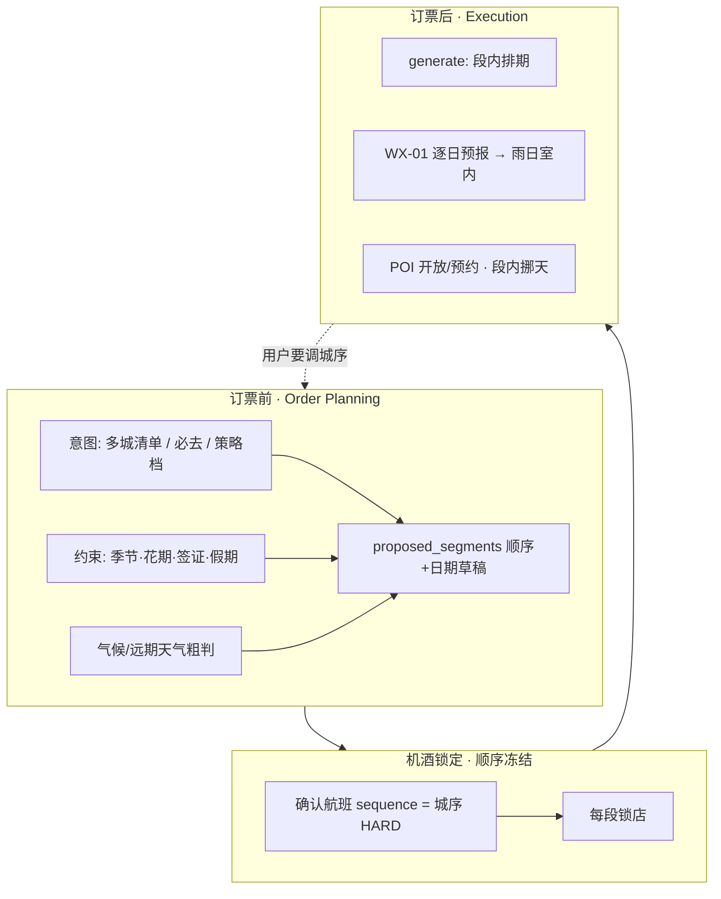

# 39 · 多城「先去哪」决策因子：航班序 · 天气 · 日期窗与其它硬细节

> **日期**：2026-08-12  
> **触发**：认同城段组合（[37](./37-多城割裂与单城组合策略.md)）与工程刀法（[38](./38-多城城段实施影响与联动改动.md)）后，补齐 **影响「城顺序 / 日期分配」的决策层**——这些常被当成小细节，实则会推翻机酒与城段。  
> **原则（travel-product-flow）**：数据/规则注入 + 人确认；**禁止**再叠一层「全能 Planner Agent」替代机酒门禁。  
> **关联**：P133 · FLOW-MC · WX-01/15 · [25 三档策略](./25-GitHub能力借鉴与规划策略三档分析.md) · [05 行前](./05-行前细节清单.md) · [03 游玩](./03-游玩项目.md)

---

## 0. 结论先讲

1. **城顺序有两套时钟**  
   - **订票前（Order Planning）**：天气季、花期、必去开放窗、签证、开合港价、行李动线 → 决定「先 A 后 B」草案。  
   - **订票后（Execution）**：已确认航班 `sequence` **就是城序真相**；天气/玩法只能在 **段内调日**，不能悄悄对调城，除非用户同意 **重搜航段**。

2. **38 的 `segments[]` 只解决「有多段」**；不解决「段该怎么排」。缺 Order 层时，用户仍会感到割裂：「系统让我先锁胡志明机票，但雨季该先去芽庄」。

3. **不要把 Order 做成一次 LLM 全局最优**；做成 **约束卡片 + 冲突检测**：  
   `proposed_order` / `constraints[]` → 与航班腿校验 → 冲突则阻断确认或要求改序。

---

## 1. 两套时钟（产品契约）



| 阶段 | 可改什么 | 不可悄悄做 |
|------|----------|------------|
| Order Planning | 城列表、顺序、每段天数、开合港建议 | 假装已有机票 |
| 锁航后 | 段内酒店/玩法/雨日替换 | 对调两城却不改航班 |
| generate 后 | optimize 段内；提示「改城序需重订机票」 | 用 20min 假边「走」到另一城 |

与三档策略（[25](./25-GitHub能力借鉴与规划策略三档分析.md)）：

| 档 | Order 层权重 | 锁航后 |
|----|--------------|--------|
| **A 机酒优先**（默认） | 弱：用户/搜票决定序；系统只 **警告** 约束冲突 | 航班序 = 城序 |
| **B 兴趣前置** | 强：必去/花期/季节 → **先出 proposed_segments**，再搜对应 OD | 仍冻结 |
| **C 玩法优先** | 最强：贴链骨架校准失败可拒生成；城序跟笔记地理聚类 | 仍冻结 |

---

## 2. 决策因子总表（小细节 · 大影响）

**严重度**：`HARD` = 不满足应阻断或强制人确认改序；`SOFT` = 注入提示/改段内安排；`WARN` = 摘要黄条。

### 2.1 航班顺序与结构

| 因子 | 为何重大 | 严重度 | 现状缺口 | 城段期建议 |
|------|----------|--------|----------|------------|
| **航段 sequence ≠ 城段顺序** | 先确认芽庄→胡志明，但 segments 写成胡志明→芽庄 → 酒店日闭环全错 | HARD | 无 segment 对齐 | 确认腿时重排/重写 `segments[]`；冲突 UI |
| **开放爪 vs 折返** | A→B→A 与 A→B→C 行李、回程机场、最后酒店完全不同 | HARD | 模板有，无产品说明 | segment.role + 末段是否回枢纽 |
| **城际时刻（半夜抵达）** | 下段首日不能排满；可能浪费一夜酒店 | SOFT→HARD | time_fit 权重有文档、执行弱 | 下段 Day1 晚开始；或警告改航班 |
| **最短衔接 / 误机缓冲** | 同日进港+出港过紧 | HARD | 弱 | 城际日禁止塞景点；或禁同日双飞除非人确认 |
| **行李直挂 / 分票** | 分票无直挂 → 必须留取行李+重新值机时间 | WARN | 无 | 注意事项看板；城际日加 tip |
| **开合港价差** | 先便宜城再贵城，或反过来，影响「先去哪」动机 | SOFT | 各段独立搜价 | Order 卡展示「若对调序，需重搜」非自动换 |
| **回程机场 ≠ 末段城** | 末段在清迈却从曼谷回家 → 必须回曼谷过夜或当日大巴/飞 | HARD | 单 destination 掩盖 | 显式「返程起点城」约束 |
| **去程抵达 ≠ 第一城玩法重心** | 飞到 SGN 却想住头顿：通勤日 vs 换城 | WARN | needs_city_change 当错误 | 加段或接受长通勤日 |

### 2.2 天气 · 气候 · 灾害季

| 因子 | 为何重大 | 严重度 | 现状 | 建议 |
|------|----------|--------|------|------|
| **气候季（雨季/旱季/台风）** | 决定 **先去哪座城**（订票前） | WARN→SOFT | 几乎无；WX-01 是 **逐日预报** | Order：气候 KB 或粗规则（国家/城×月）；**不能**等 generate 后再对调城 |
| **逐日预报（7–15 天）** | 只影响 **段内** 室内外、是否挪天 | SOFT | ✅ WX-01 写入 `days[].weather` | 锁航后用；多城须 **按段城市** 拉预报（今日多半仍按单一 destination） |
| **预报窗口外的远期旅行** | 无可靠逐日；只能用气候 | WARN | 易被 LLM 瞎编晴雨 | 远期禁用「精确避雨排城」；改气候建议 |
| **极端预警** | 停航/封路 | HARD | WX-02 ⏸ | 有预警时提示勿锁下段机票 |
| **海拔/温差**（高地↔海边） | 衣物、身体、日程强度 | SOFT | 行前清单有衣物、未接多城 | NOTE-BOARD + 段标签 |

**关键纠偏**：用户说的「天气导致先去哪」主要是 **气候季 / Order 层**，不是 generate 当天的雨天 tip。WX-01 解决不了城序。

### 2.3 日期窗 · 「只能特定时候去」

| 因子 | 例 | 严重度 | 数据应从哪来 | 建议落点 |
|------|----|--------|--------------|----------|
| **物候/花期** | 樱花、红叶、薰衣草、极光概率窗 | HARD（对主题游） | KB / 用户必去标注 `visit_window`；禁 UGC 当事实 | `must_see[].window` → 强迫该城段落在窗内，否则冲突卡 |
| **潜水/海况季** | 干季能见度 | SOFT/HARD | 目的地 KB | 同 |
| **节庆/封路** | 泼水节、宗教日、国庆 | WARN | 日历 KB | 段日期避开或加 tip |
| **POI 季休/周一闭馆** | 博物馆周休、滑雪场季外 | SOFT（段内） | Places hours / 官方；[03](./03-游玩项目.md) `best_visit_window` | generate 段内排期；闭馆日换 POI |
| **预约放票日** | 热门馆需提前 N 天 | WARN | 官方 | 行前看板；不自动改城序 |
| **极昼/极夜、寺庙开放** | 高纬、宗教场所 | SOFT | KB | tips |
| **公共假期机票/酒店暴涨** | 春节、当地长假 | SOFT | 价已在搜价结果里 | Order 提示「该周溢价」 |
| **签证/停留期** | 免签 15 天切两城 | HARD | Compliance KB | 总天数校验；过境签与中转 |

文档 [03](./03-游玩项目.md) 已有 `best_visit_window` / `opening_hours` 字段意向；多城前 **几乎未进入 Order 决策**，只可能进单城 generate 软约束。

### 2.4 地理与交通现实

| 因子 | 影响 | 严重度 | 建议 |
|------|------|--------|------|
| **陆地不可达当飞** | 两城无合理城际 → 不该排成相邻段 | HARD | 城际搜不到票/车时警告 |
| **同日跨岛/跨国** | 耗尽整天 | HARD | 强制 transit-only day |
| **时差** | 日界线、到达日「丢一天」 | HARD | 段日期用 **到达当地日历** |
| **驾驶左/右、山路** | 自驾段 | WARN | tips；Directions 海路山路已有 TRN 意识 |

### 2.5 行李 · 精力 · 体验节奏

| 因子 | 影响 | 严重度 | 建议 |
|------|------|--------|------|
| **拖行李换城次数** | 过多城际 = 体验崩 | WARN | 默认建议 ≤N 段；超出确认 |
| **先紧后松 / 先海边后城市** | 主观但常被问 | SOFT | 策略预设或用户偏好 tag |
| **亲子/老人** | 忌连续早航班 | SOFT | time_fit 加强 |

### 2.6 合规与行前（常被忽略却能一票否决）

| 因子 | 影响 | 严重度 | 与 P130 |
|------|------|--------|---------|
| 签证是否覆盖所有段国 | 不能先去无签国 | HARD | 看板 + Order 冲突 |
| 过境第三国 | 航序被护照限制 | HARD | 与航班中转联动 |
| 入境口岸限制 | 某些签只允许特定机场 | HARD | KB |
| 现金/药/海关 | 不改城序，改行李 | SOFT | NOTE-BOARD |

### 2.7 兴趣 / 印证 / 必去（策略 B/C）

| 因子 | 影响 | 严重度 | 建议 |
|------|------|--------|------|
| **必去 POI 所在城** | 倒推必须有该城段 | HARD | `must_see` → 强制 segment 存在 |
| **必去日期窗 ∩ 航班** | 窗与航序冲突 | HARD | 冲突卡：改窗 / 改序 / 放弃 |
| **印证采纳跨两城** | 一篇攻略胡志明+美奈 | WARN | 拆段或提示加段（doc 34） |
| **closed pool 单城** | 第二城玩法漂 | HARD | FLOW-MC-4 按段池 |

---

## 3. 「航班顺序」会具体导致什么问题（案例化）

### 案例 A · 序反了

用户气候上应 **旱季先芽庄、再胡志明**，但先随手确认了 `PKX→SGN` 再想加芽庄。

| 若系统… | 结果 |
|---------|------|
| 只追加腿、不改 segments | 酒店/玩法仍按「整趟胡志明」→ 割裂（现状） |
| 自动对调城段但不改票 | 行程写芽庄在前，人却已飞 SGN → **假行程** |
| **正确** | 黄条：「当前机票序 = 先胡志明。要对调请先取消/改去程，或接受先胡志明」 |

### 案例 B · 开放爪末段

`上海→清迈→曼谷→上海`：若返程锁在 BKK，则 **清迈段不能排在最后**；最后过夜应在曼谷或接受清迈→曼谷当日赶路。

### 案例 C · 城际日被当成玩当天

`SGN 23:00 抵达 DLI`：下一段若仍排满瀑布，必崩。应 **HARD：抵达日≤半日或纯休息**（对齐 18 time_fit）。

### 案例 D · 回程日无酒店 vs 中段换城日

P92 已禁返程日过夜酒店；**中段城际日**同样常无「当晚店」或店在下一城——`hotelDayLoop` 若全局套用会制造空窗或错店（并打 P128）。

---

## 4. 与工程刀法（38）如何衔接

38 解决 **容器**；本篇解决 **装进容器前的排序与冲突**。

| 层 | 放哪一刀 | 做什么 |
|----|----------|--------|
| **Order 最小** | **FLOW-MC-0.5 / 与刀 1 同批或紧后** | `constraints[]` 或 `must_see[].window` 可选；锁航时 **航班序→segments 序** 校验；冲突黄条 |
| **气候建议** | 可后于刀 2 | 城×月气候 tip（静态 KB），**不**自动改票 |
| **逐日天气** | 刀 4 + 修 WX | 预报按 **segment.city** 拉；只改段内 |
| **花期/季休** | B/C 档增强 | 冲突检测；数据不足则 WARN 不 HARD |
| **签证** | P130 / Compliance | Order 总天数与多国段校验 |

**推荐新增的薄结构（避免大而全 Agent）**

```ts
type TripConstraint = {
  id: string;
  kind: 'season' | 'visit_window' | 'visa' | 'flight_order' | 'open_jaw' | 'other';
  severity: 'hard' | 'soft' | 'warn';
  segment_ids?: string[];      // 约束作用城
  date_start?: string;
  date_end?: string;
  message: string;
  source: 'user' | 'kb' | 'weather_climate' | 'flight' | 'system';
};

// trip_request 增量（可选）
must_see?: { name: string; city?: string; window_start?: string; window_end?: string }[];
proposed_order_note?: string; // 人读的「建议先芽庄」
```

锁航 / 生成前跑一次：

```text
validate_segment_order(flights, segments, constraints) -> { ok, blockers[], warnings[] }
```

- `blockers` → 不能 `canGenerate` / 不能确认下一段票（可配置）  
- `warnings` → 摘要黄条  

符合 playability 默认序：**规则校验 > 再 prompt**。

---

## 5. 决策 UI（避免再造三个面板）

在现有摘要 / 下一步卡上增加 **「城序与约束」一条**，而不是新 App：

1. **城段时间线**（来自 38）：城 · 日期 · 锁票/锁店状态  
2. **冲突条**：例「樱花窗 3/20–4/5，但京都段在 4/20」→ [改段日期] [忽略]  
3. **气候一句**：例「9 月中部雨季偏多，建议海边段提前」（可点「为何」）  
4. **锁航文案**：确认城际前：「将固定城序为 胡志明→芽庄」

策略 B：在搜第一张票前，允许拖拽城序 + 调天数（只改 `segments` 草稿）。  
策略 A：搜票主导；拖拽城序若与已确认腿冲突 → 禁用并说明。

---

## 6. 明确不做（防 scope 爆炸）

| 不做 | 原因 |
|------|------|
| 自动根据天气对调已锁航段 | 无改签能力；易出假行程 |
| 全球物候实时 API 一期打满 | 数据与幻觉风险；先用户窗 + 薄 KB |
| Crew/多 Agent「决策中枢」 | 与 18/24/skill 冲突 |
| 用 UGC 印证当花期/开放事实 | doc 34 L-fact 规则 |
| 一期联合多城最低价搜序 | 18 Phase1 已否 |

---

## 7. 验收故事（决策层）

1. 两城草稿：系统提示气候偏好序；用户仍先锁反序机票 → 城段跟机票，黄条保留「与气候建议不一致」。  
2. 必去带 `window`：段日期在窗外 → **不可 generate**，提示改日期或移城。  
3. 开放爪：返程 BKK，末段若在 CNX → blocker「请把曼谷放在返程前或改返程机场」。  
4. 城际深夜抵达 → 下段首日节点数受限（代码 enforce）。  
5. 远期旅行（无预报）→ 不出现假精确雨日排城；只出现气候级文案。

---

## 8. 与 GitHub 调研的对照（能参考什么）

> 源：[24](./24-GitHub旅行Agent调研与机酒玩法顺序讨论.md) · [25](./25-GitHub能力借鉴与规划策略三档分析.md)。  
> **结论：没有可直接搬来的「先去哪」决策库；可参考的是「约束怎么算、谁检查」，不是 Crew/搜网排城。**

### 8.1 它们实际怎么「算」这类问题

| 来源 | 对「城序 / 天气 / 日期窗」实际做法 | 算不算决策库 |
|------|-----------------------------------|--------------|
| **nirbar** 等机酒 Tool 环 | 只搜飞/酒；人确认发信；**不管**日玩法与城序 | ❌ 无 |
| **CrewAI 官方 / 多角色搜网** | City Selection 等角色用 **网页摘要** 让 LLM 写「建议去哪」 | ❌ 软文案，无硬校验 |
| **TravelPlanner 学术基准** | 给定工具结果后测计划是否满足 Environment / Commonsense / **Hard**；公开 Final Pass **极低** | ⚠️ 证明「盲生成过不了约束」，不是排城算法 |
| **FloatTrip** | 高德 **封闭 POI 池** + 地理聚类；Planner⇄**Reviewer**；TimeCheck（时刻/开放类）；评测 pass@k | ✅ 参考 **规则打回**；非气候排城 |
| **TripStar** | 笔记→高德校准；**缺景点直接失败** | ✅ 参考 **缺项失败**；非多城序 |
| **shaheen / 带天气 tool** | Amadeus + **天气 tool 注入**再写行程 | ⚠️ 接近 WX 注入；**不是**订票前对调城序 |
| **kbhujbal 等 API 先行** | 并行拉 Places/活动 → LLM 合成 | ⚠️ 架构 C；无城段约束引擎 |

架构 D 示意图里的「POI 池(+天气)」= **生成时注入天气影响室内外**，与本文「气候季决定先去哪」不是同一层（见 §2.2）。

### 8.2 对本仓「先去哪」可借 / 不借（对齐 25）

| 可借 | 落成形态（= 本文 §4） |
|------|----------------------|
| 可执行约束检查 > 多轮反思 | `validate_segment_order` → blocker/warn |
| 缺项失败（TripStar） | 必去 `visit_window` 与段日期冲突 → 拒 generate |
| TimeCheck / 跨城距离（FloatTrip） | 深夜抵达半日；城际假 20min 禁止；跨段距离 |
| HITL（nirbar） | 锁航文案固定城序；对调须人确认重搜 |
| 天气作 **工具事实** | WX 按段拉预报（段内）；气候 KB 仅 WARN |
| 兴趣轻前置（24 §6.5） | B 档 must_see 倒推「必须有该城段」 |

| 不借 | 原因 |
|------|------|
| City Selection Agent 搜网排城 | 无坐标/无航班真相，易幻觉 |
| 完整 LangGraph 决策中枢 | 18/25 已否 |
| 把 TravelPlanner 当可跑产品 | 它是基准，Pass Rate 极低 |
| 用天气 tool **自动改已锁航序** | 无改签；假行程 |

### 8.3 一句话

GitHub 侧 **没有**现成的「气候+花期+航班序」决策库可抄；它们验证了同一件事：**约束必须代码查，不能靠多 Agent 嘴炮**。本文 FLOW-MC-ORDER 正是把 24/25 的 Reviewer/缺项失败 **上移到订票前的城序层**。

---

## 9. 文档位置与 TODO 建议

| 项 | 说明 |
|----|------|
| 策略容器 | [37](./37-多城割裂与单城组合策略.md) |
| 工程联动 | [38](./38-多城城段实施影响与联动改动.md) |
| **本决策层** | 本文（含 §8 GitHub 对照） |
| GitHub 源调研 | [24](./24-GitHub旅行Agent调研与机酒玩法顺序讨论.md) · [25](./25-GitHub能力借鉴与规划策略三档分析.md) |
| TODO | `FLOW-MC-ORDER`：**✅** 航班序 + 气候城×月 WARN + `must_see` visit_window（`climateHints.ts`） |
| 天气 | WX 多城按段拉取；气候 KB ≠ WX-01 |
| 行前 | P130 接签证/行李类 HARD/SOFT |

---

## 10. 一句话

**城段 schema 解决「多城装得下」；航班序解决「人已经买了哪条路」；天气季与日期窗解决「该不该买这条路」。**  
三者冲突时以 **人确认的机票序为 HARD**，约束与气候只能 **事前建议、事后警告、段内修补**——不能静默改城序。这才是多城不割裂的决策闭环。
